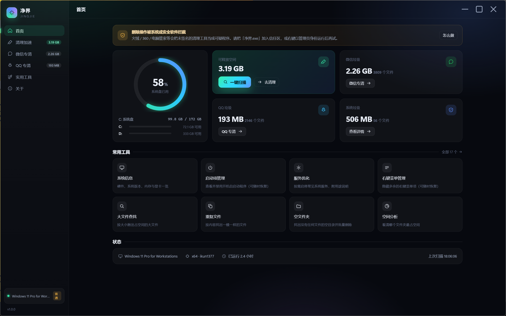
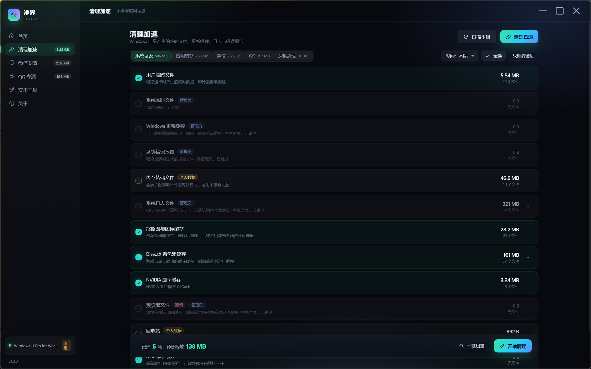

# 净界 JingJie

> Windows 系统清理与优化工具 —— 绿色免安装，单文件启动，自带界面。
> 清理系统垃圾、微信 / QQ 聊天缓存、浏览器与国产软件缓存，外加 17 个常用维护工具。

## 下载

**[⬇ 下载 净界 v1.0.0（约 33 MB）](https://github.com/wodemi/jingjie/releases/latest)**

解压到任意目录 → 双击 `净界.exe` 即可，不需要安装 Node、不需要装 .NET SDK。



## 为什么要做这个

Dism++ 好用但界面偏"工程师向"，WiseCare365 功能全但夹杂广告和不透明选项。
净界的目标是：**该删的默认帮你勾好，不该删的明确告诉你为什么不能删**。

- 清理项按 `安全 / 个人数据 / 谨慎` 三档标注，默认只勾安全项
- 微信、QQ 的聊天图片 / 视频 / 文件默认**不勾**，勾了也会二次确认
- 需要管理员的项目会灰显并写明原因，不会静默失败
- 注册表清理**删除前自动导出 `.reg` 备份**到 `data\regbackup\`

## 能清理什么

| 分组 | 内容 |
|---|---|
| 系统垃圾 | 用户/系统临时文件、Windows 更新缓存、系统日志（CBS/DISM/更新）、错误报告、内存转储、缩略图与图标缓存、DirectX / NVIDIA 着色器缓存、字体缓存、预读取、回收站 |
| 应用缓存 | Edge / Chrome / Firefox、Steam 下载缓存、WPS、微软商店、NVIDIA 安装包、百度网盘、剪映、开发工具缓存（npm / yarn / pnpm / pip / NuGet / Gradle / Maven）、**自动发现**其它 Chromium 内核软件的网页缓存 |
| 微信专清 | 缓存与日志、聊天图片、视频与语音、接收的文件、手机备份（后四项默认不勾） |
| QQ 专清 | 缓存与日志、表情与贴图、聊天图片、视频、接收的文件（适配新版 QQNT 的 `账号\nt_qq` 结构） |
| 注册表 | 卸载残留、失效启动项、无效程序注册、MUI 名字缓存、共享 DLL 记录 |
| 深度清理 | 休眠文件、系统还原点、WinSxS 组件清理、Windows.old、驱动备份、安装包缓存 |

## 17 个工具

系统信息 · 启动项管理（不认识的程序可一键联网查询）· 服务优化 · 右键菜单管理 · 大文件查找 · 重复文件 · 空文件夹 · 空间分析 · 进程管理 · 网络诊断 · 文件粉碎 · 电源工具 · 开机耗时 · 环境变量 · 系统还原 · Hosts 编辑 · 系统修复（SFC / DISM / 磁盘检查）



## 界面与操作

- 深色 / 浅色主题，记住上次选择
- 窗口拖到屏幕左/右边缘自动半屏，拖到顶部最大化，拖回中间还原
- 边框可自由拖拽缩放，布局自适应
- 关闭按钮 = 收进托盘；右键托盘图标可退出
- 系统级清理需要管理员：页面上有「以管理员身份重启」按钮，点一次弹一次 UAC

## 第一次运行可能遇到的提示

| 提示 | 原因 | 怎么办 |
|---|---|---|
| Windows「已保护你的电脑」 | 没有数字签名 | 点「更多信息」→「仍要运行」 |
| 火绒 / 360 / 管家拦截 | 安全软件把清理工具当可疑程序 | 选「允许」，或把整个文件夹加入信任区 |
| 系统项目点不动、显示「需管理员」 | 需要提权 | 点橙色横幅「以管理员身份重启」，UAC 点「是」 |
| 提示缺少 WebView2 | Win10 早期版本可能没装 | 按提示装 [WebView2 运行时](https://go.microsoft.com/fwlink/p/?LinkId=2124703) |

> 不建议把程序放在 `C:\Program Files` 这类受保护目录 —— 程序需要在自己目录下写 `data\`。
> 程序会自动回退到 `%LOCALAPPDATA%\JingJie` 或 `%TEMP%\JingJie`，但放在普通目录最稳。

## 数据说明

- 所有数据都在程序目录的 `data\` 下：`jingjie.log`（日志）、`settings.json`（设置）、`regbackup\`（注册表备份）、`webview\`（界面缓存）
- 不联网上传任何文件清单，不收集任何信息；唯一的网络请求是清理项说明里的「联网搜一下」（打开浏览器搜索页）
- 想彻底卸载：删掉整个文件夹即可

## 从源码构建

需要 Windows + .NET Framework 4.x 的 `csc.exe`（系统自带）+ Node.js（仅构建时用）。

```powershell
# 生成图标 → 编译 净界.exe → 组装 dist → 创建桌面快捷方式
powershell -ExecutionPolicy Bypass -File .\build.ps1

# 只重新编译，不复制 node.exe（dist 里已有）
powershell -ExecutionPolicy Bypass -File .\build.ps1 -SkipNode

# 额外打包成 zip
powershell -ExecutionPolicy Bypass -File .\build.ps1 -SkipNode -Zip
```

产物在 `dist\`：`净界.exe` + `runtime\node.exe` + `app\`（前端与清理引擎）+ 三个 WebView2 DLL。

### 结构

```
src/JingJie.cs        WinForms + WebView2 外壳：无边框窗口、托盘、贴边、缩放、提权、单实例
app/server/server.js  本地 HTTP 服务（127.0.0.1 随机端口 + 启动令牌），只做本机通信
app/server/catalog.js 清理项目录（含软件缓存路径自动发现）
app/server/job.js     扫描与清理作业（并发、错误分类、进度事件）
app/server/reg.js     注册表扫描 / 备份 / 删除
app/server/tools.js   17 个工具的后端实现
app/web/              界面（原生 HTML/CSS/JS，零框架、零构建）
```

## 已知限制

- 未签名，SmartScreen 会提示（个人项目，没买代码签名证书）
- 同一用户只能开一个实例（第二个会激活第一个）
- 部分项目需要管理员权限才能删除
- Windows 10 1809 以下未测试

## 免责声明

本项目按现状提供，清理行为不可撤销。请在使用前阅读每一项的说明，重要数据自行备份。
因误删导致的损失由使用者自行承担。

## 许可

未指定许可证。如需在自己的项目中使用其中代码，请先联系作者。
